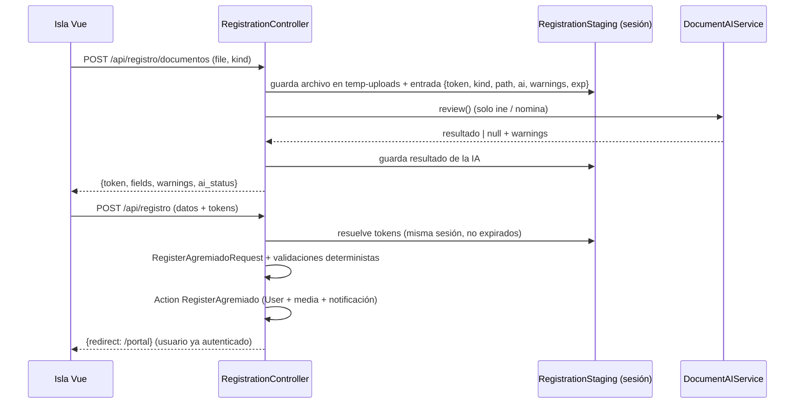

# Plan: registro de agremiados como página Vue (`/registro`)

Reemplaza la página Livewire/Filament `Register` (613 líneas) por una página pública Blade + isla Vue. Se reutiliza `DocumentAIService` sin cambios.

## Decisiones acordadas (grilling)

| # | Decisión |
|---|---|
| Q1 | Página en `/registro` con `landing.layout` + isla `registro/register-form`. `/portal/register` redirige 301. Se quita `->registration()` del panel. |
| Q2 | Wizard de 3 pasos: Documentos → Tus datos → Cuenta y envío. La IA nunca bloquea. |
| Q3 | `POST /api/registro/documentos` (multipart) guarda en `temp-uploads` y devuelve `token` + campos extraídos. El resultado completo de la IA queda en la **sesión del servidor**. El envío final manda solo tokens. |
| Q4 | Se borra el código Livewire. Lógica nueva: `RegisterAgremiadoRequest` + Action `RegisterAgremiado` + `RegistrationController`. Pruebas reescritas como HTTP/JSON. |
| Q5 | `Auth::login()` + redirección a `/portal`. Rol `Agremiado` forzado en servidor. Se mantiene la notificación de bienvenida. |
| Q6 | Composable nuevo `useIslandUpload` (XHR: progreso, cancelar, reintentar). `useIslandForm` no se toca. La foto también sube por el endpoint de documentos (`kind=photo`, sin IA). |
| Q7 | `throttle` por ruta (12/min documentos, 5/min envío). Tokens expiran en 2 h. Comando `registration:purge-temp` cada hora borra temporales de más de 3 h. |
| Q8 | Firma visual: **credencial de agremiado en vivo** que se arma mientras la IA lee los documentos. |
| Q9 | Accesibilidad y UX según checklist (Fase 4). |
| Q10 | Pruebas Pest feature + `vue-tsc` + `npm run build` + Pint + revisión manual a 320/768/1024/1440 px. |

## Supuestos (a confirmar solo si discrepas)
- El aviso de privacidad sigue siendo **informativo** (igual que hoy), sin casilla obligatoria.
- No se pide verificación de email (igual que hoy).
- El paso 1 exige INE, nómina y foto (igual que hoy: los tres son `required`). Si la IA falla, el usuario igual avanza y completa a mano.

## Arquitectura



El cliente nunca envía `extracted_data`: se lee de la sesión, por lo que no se puede falsificar.

## Fase 1 — Backend

**Nuevos**
- `app/Http/Controllers/RegistrationController.php`: `index` (renderiza la vista; si hay sesión, redirige a `/portal`), `storeDocument`, `store`.
- `app/Http/Requests/StoreRegistrationDocumentRequest.php`: `kind` ∈ `ine|nomina|photo`. `ine` y `nomina` aceptan pdf/jpg/png/webp hasta 10 MB. `photo` acepta imagen hasta 2 MB.
- `app/Http/Requests/RegisterAgremiadoRequest.php`: mismos campos y reglas que el formulario actual:
  - `name`, `surnames`, `email` (único), `phone`, `birth_date` (mayor de 18 años), `curp` (`UniqueCurp` + regex), `nss` (único), `category`, `salary`, `address`.
  - `password` con `Password::defaults()` y `confirmed`.
  - `ine_token`, `nomina_token`, `photo_token`.
  - En `after()`: CURP contra fecha de nacimiento, INE vencida (vigencia < año actual) y nómina de más de 31 días, leyendo el resultado de la IA desde la sesión.
- `app/Services/RegistrationStaging.php`: `stage()`, `resolve($token, $kind)`, `forget()`. Entradas en `session('registration.staged')` con `exp` de 2 h. Archivos privados en `temp-uploads/registro/{uuid}.{ext}`.
- `app/Actions/RegisterAgremiado.php`: crea el `User` en transacción, con `role=Agremiado`, `is_active=true` y contraseña hasheada. Mueve la foto de `local` a `public/profile-photos` y fija `photo_path`. Adjunta INE y nómina en estado `Pending` con las mismas `customProperties` que hoy (`extracted_data`, `ai_flagged`, `ai_flags`, `ai_error`, `ai_processed_at`). Envía la notificación de bienvenida y borra los temporales.
- `app/Console/Commands/PurgeRegistrationTemp.php` (`registration:purge-temp`), programado cada hora en `routes/console.php`.
- Rutas en `routes/landing.php`:
  - `GET /registro` → `register`.
  - `POST /api/registro/documentos` → `registro.documentos.store`, con `throttle:12,1`.
  - `POST /api/registro` → `registro.store`, con `throttle:5,1`.
  - `Route::redirect('/portal/register', '/registro', 301)`.

**Eliminados**
- `app/Filament/Pages/Auth/Register.php`.
- `resources/views/filament/pages/auth/register.blade.php` y `register-layout.blade.php`.
- `->registration(Register::class)` en `PortalPanelProvider`, más imports muertos.

**Actualizados (referencias rotas)**
- `resources/views/landing/components/navbar.blade.php:51` → `route('register')`.
- `resources/js/components/portal/qr-generator.vue:193` y `resources/views/filament/widgets/qr-generator-widget.blade.php:12` → `/registro`.
- Enlace "Crear cuenta" en la página de login de Filament (hoy lo genera el registro de Filament): agregarlo manualmente apuntando a `route('register')`.

## Fase 2 — Frontend (Vue Islands, sin Inertia)

Vista: `resources/views/landing/register.blade.php`, con `<title>` y meta description propios, `<noscript>` con aviso, y la isla:

```blade
<div data-vue="registro/register-form" data-client="load" data-props="{{ json_encode([...]) }}"></div>
```

Props: URLs de los endpoints, `loginUrl`, `privacyUrl` y límites de tamaño.

Archivos en `resources/js/`:
- `composables/useIslandUpload.ts`: XHR con CSRF, `progress`, `cancel()`, `retry()`, errores 422 normalizados.
- `components/registro/register-form.vue`: orquestador (< 200 líneas). Usa `useIslandForm` para el envío final.
- `components/registro/credential-preview.vue`: la credencial en vivo. Sticky en `lg+`, franja compacta en móvil.
- `components/registro/document-dropzone.vue`: arrastrar o seleccionar, progreso, estado de la IA, reemplazar y quitar.
- `components/registro/step-documents.vue`, `step-data.vue`, `step-account.vue`.
- Tipos compartidos en `components/registro/types.ts`.

## Fase 3 — Diseño (frontend-design + daisyUI)

- **Tokens**: solo semánticos del tema `siut` (`bg-base-100/200`, `text-primary`, `btn-primary`…). Sin colores fijos, porque el tema viene de la BD.
- **Tipografía**: `font-display` (Spline Sans) en títulos, Inter en cuerpo, `font-serif` (Fraunces) solo para el nombre en la credencial.
- **Componentes daisyUI**: `steps`, `fieldset`, `input`, `textarea`, `file-input` (base de la dropzone), `validator`, `alert`, `badge`, `progress`, `loading`, `skeleton`, `btn`. Leer la guía de cada componente antes de usarlo.
- **Íconos**: `@lucide/vue`.
- **Firma**: la credencial se compone con la foto (aparece al subirla) y los campos que se "materializan" con una barra de escaneo cuando llega la lectura de la IA.
- **Movimiento**: un solo momento (el escaneo), con `tailwind-animations`. `motion-safe:` en todo y fallback estático con `prefers-reduced-motion`.
- **Copy**: verbos concretos ("Subir INE", "Continuar", "Crear mi cuenta"). Errores que explican qué pasó y cómo corregirlo.

## Fase 4 — UX y accesibilidad

- Foco al `<h2>` del paso al avanzar o retroceder. Un solo `<h1>` en la página.
- Estado de la IA en `role="status"` / `aria-live="polite"`.
- Campos prellenados con insignia de texto "Leído de tu INE" o "Leído de tu nómina", nunca solo color.
- Error 422 → salta al primer paso que contenga un campo con error y enfoca ese campo.
- Advertencias de INE vencida y nómina antigua junto al documento correspondiente.
- Sin `localStorage` con datos personales. Aviso `beforeunload` si hay avance sin enviar.
- Foto: vista previa, recorte cuadrado con `object-cover`, `capture="user"` en móvil. Sin librería de recorte.
- Estados de carga, error y vacío en cada paso.
- Contraste AA, foco visible, objetivos táctiles ≥ 44 px, `label` asociado a cada campo, `autocomplete` correcto (`given-name`, `family-name`, `email`, `tel`, `bday`, `new-password`).

## Fase 5 — Pruebas

Reescribir lo relativo al registro en `tests/Feature/AgremiadoRegistrationAndDocumentsTest.php` (las pruebas de Profile y revisión de documentos no se tocan) y añadir `tests/Feature/RegistrationFlowTest.php`:

- `GET /registro` responde 200 y monta la isla. Con sesión iniciada redirige a `/portal`.
- `/portal/register` redirige 301 a `/registro`.
- Subir documento válido con `Http::fake` de la IA → `token` + campos. Tipos y tamaños inválidos → 422.
- IA caída, con throttle o deshabilitada → `ai_status` degradado y se puede seguir.
- Token expirado, inexistente o de otra sesión → 422.
- Registro feliz: rol `Agremiado` aunque el payload traiga `role=admin`, documentos `Pending` con `extracted_data` del servidor, foto movida, usuario autenticado, notificación creada.
- Rechazos deterministas: formato de CURP, CURP ≠ fecha de nacimiento, INE vencida, nómina de más de 31 días, CURP/email/NSS duplicados, menor de edad.
- `throttle` devuelve 429 al exceder.
- `registration:purge-temp` borra temporales antiguos y conserva los recientes.

## Fase 6 — Verificación final

1. `php artisan test --compact` (filtrado y luego suite completa).
2. `vendor/bin/pint --dirty`.
3. `npx vue-tsc --noEmit` y `npm run build`.
4. Revisión manual en navegador a 320, 768, 1024 y 1440 px: recorrer el wizard con teclado, con IA habilitada y deshabilitada, y con `prefers-reduced-motion`.
5. Comprobar que no quedan referencias a `filament.portal.auth.register`.

## Riesgos y notas

- **Sesión como almacén de tokens**: dos pestañas comparten sesión; los tokens son por entrada, así que no se pisan.
- **Límites de PHP**: `upload_max_filesize` y `post_max_size` deben admitir 10 MB. Verificar en el hosting.
- **Timeout de la IA**: `DOCUMENT_AI_SYNC_TIMEOUT` es 25 s. La UI debe mostrar progreso y permitir continuar si tarda más.
- **Despliegue**: `registration:purge-temp` depende del scheduler ya existente en `console.php`.
- **Orden de implementación**: Fase 1 (con pruebas) → useIslandUpload → componentes → diseño y UX → limpieza de referencias → verificación.
